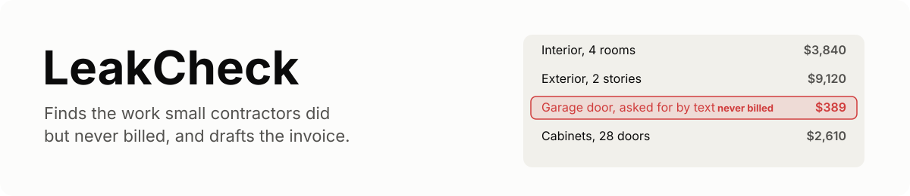
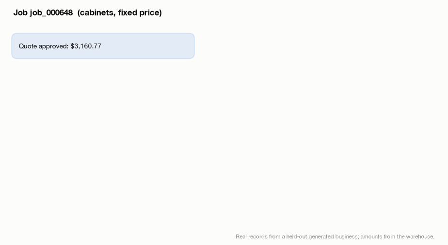
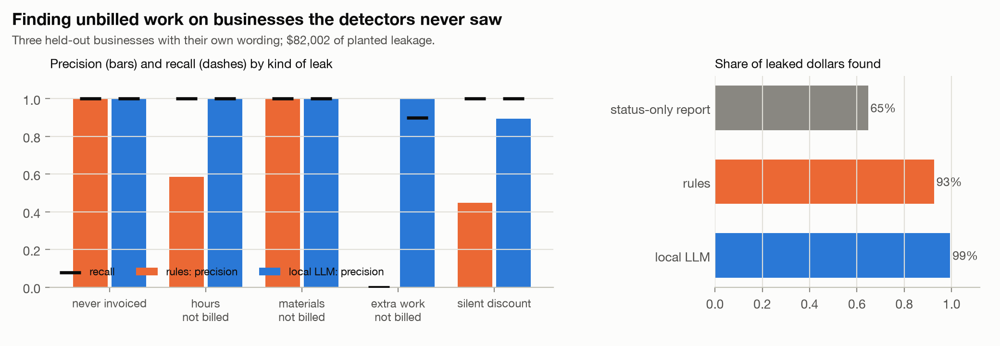
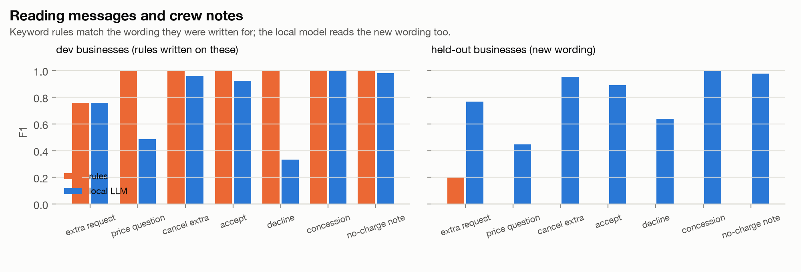
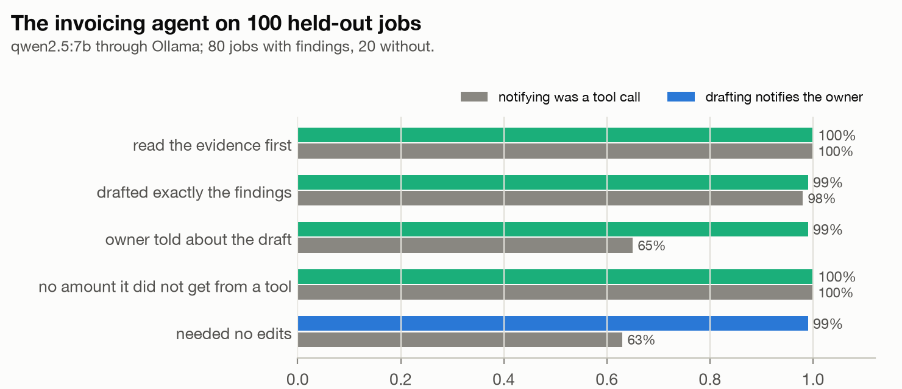
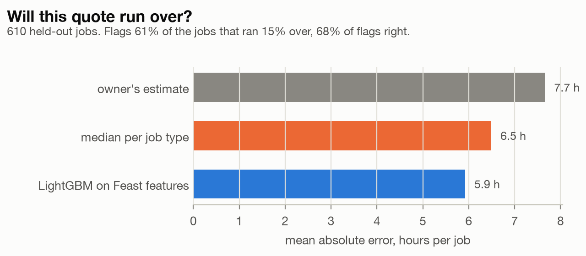

<picture>
  <source media="(prefers-color-scheme: dark)" srcset="docs/assets/banner-dark.svg">
  
</picture>

[](https://github.com/Sanika0212/LeakCheck/actions/workflows/ci.yml)


**LeakCheck finds the work a small contractor did and never billed, prices it from the
record, and puts a draft invoice in front of the owner with the evidence attached.**

The money is not hidden in a ledger. It is in the gap between what the crew did and what
the office invoiced: a visit that ran four hours longer than the quote, a gallon of paint
bought on the job and never added, a customer who asked for an extra door mid-job over
text, a discount the owner never approved. Every field-service tool can show "completed
jobs with no invoice". On the held-out businesses here, that report finds 65% of the leaked
dollars and nothing at all in the four other kinds of leak.

## The proof of concept said no

Before any pipeline, one DuckDB script with keyword rules ran against raw exports and was
scored on [four criteria written first](poc/criteria.md). It found most of the money and
still failed, because the list it produced was 69% right, and an owner stops reading a list
that is a third wrong. [The decision was no-go](poc/report.md), and the open question was
whether reading the text properly would clear the same bar.

It does. The same four criteria, same held-out businesses, same ground truth:

| Criterion | Bar | Keyword rules | Full pipeline |
|---|---|---|---|
| Share of leaked dollars found | at least 70% | 92.6% | **99.4%** |
| Times the status-only report | at least 1.5x | 1.43x | **1.54x** |
| Flagged jobs that are real | at least 80% | 69.6% | **97.8%** |
| Six months of data | under a minute | 0.13 s | **6.4 s for all 18 months** |

<picture>
  <source media="(prefers-color-scheme: dark)" srcset="docs/assets/story-dark.gif">
  
</picture>

## Results

Every number below comes from a script in `eval/` and its file in `runs/`. The data is
generated (see [Honest notes](#honest-notes)); detectors and prompts were written against
three businesses, and everything reported here is measured on three other businesses whose
messages use wording the detectors never saw.

### Does it find the money?

<picture>
  <source media="(prefers-color-scheme: dark)" srcset="docs/assets/detection-dark.png">
  
</picture>

Three held-out businesses, 623 jobs, $82,002 of planted leakage, as of 2025-10-31.

| | Status-only report | Keyword rules | LeakCheck (local model) |
|---|---|---|---|
| Leaked dollars found | 64.7% | 92.6% | **99.4%** |
| Jobs flagged | 19 | 102 | 90 |
| Flagged jobs that are real | 100% | 69.6% | **97.8%** |
| Leaks found (recall) | 21.1% | 77.8% | **97.8%** |
| Never invoiced | 1.00 P / 1.00 R | 1.00 / 1.00 | 1.00 / 1.00 |
| Hours not billed | finds none | 0.59 / 1.00 | 1.00 / 1.00 |
| Materials not billed | finds none | 1.00 / 1.00 | 1.00 / 1.00 |
| Extra work not billed | finds none | 0.00 / 0.00 | 1.00 / 0.90 |
| Silent discount | finds none | 0.45 / 1.00 | 0.89 / 1.00 |

The status-only report is perfectly precise and nearly blind: the one leak it understands
is a job with no invoice at all. Keyword rules reach most of the dollars and bring 33 false
positives with them, because two things in the records look exactly like leaks and are not:
a callback visit the owner does not charge for, and a credit the office already promised in
a message. Reading those messages is what separates the last two columns.

### Do keyword rules survive new wording?

<picture>
  <source media="(prefers-color-scheme: dark)" srcset="docs/assets/extraction-dark.png">
  
</picture>

| Extractor | Dev businesses | Held-out businesses |
|---|---|---|
| Keyword rules | 0.974 accuracy | 0.760 |
| qwen2.5:7b, local | 0.823 | **0.824** |

This is the honest part of the project. Written against the first three businesses, the
rules look excellent: F1 1.00 on six of the seven labels. Against businesses that word things
differently they collapse to F1 0.00 on every label but one, while staying just as
confident. The local model is less accurate on the wording it was tuned against and loses
nothing on wording it has never seen, which is the only property that matters once the
product meets a real contractor. Both extractors feed the same detectors, so the detection
table above is this difference, in dollars.

### Can the agent be trusted to act?

<picture>
  <source media="(prefers-color-scheme: dark)" srcset="docs/assets/agent-dark.png">
  
</picture>

A LangChain agent reads the evidence for one job, drafts an invoice covering its findings,
and the owner approves it. Measured on 100 held-out jobs, 80 with findings (stratified by
leak type) and 20 clean, each scored on four checks:

| Check | Notifying was a tool call | Drafting notifies the owner |
|---|---|---|
| Read the evidence before anything else | 100% | 100% |
| Drafted exactly the job's findings, once | 98% | 99% |
| Owner told about the draft | 65% | **99%** |
| No dollar figure that did not come from a tool | 100% | 100% |
| Needed no edits (all four) | 63% | **99%** |

The middle column is why this project has two columns. Asked to call `notify_owner` with
the draft id it had just received, the model passed an invented id such as `draft_0001` on
35 of 100 jobs. The tool refused it (`{"error": "no draft draft_0001"}`), so nothing wrong
was sent and nothing was logged as sent, but the owner was never told either. A step that
must always happen does not belong in the model's hands, so creating a draft now writes the
notification in the same transaction, and `notify_owner` is for anything beyond that.

What did not have to be fixed is more interesting than what did. The agent never wrote a
dollar figure a tool had not returned, and the drafting tool takes finding ids rather than
amounts, so it cannot: all 79 drafted lines matched the warehouse exactly. It drafted
nothing on all 20 clean jobs. Median 15.9 s per job on a laptop.

### Does the quote model know which jobs will run over?

<picture>
  <source media="(prefers-color-scheme: dark)" srcset="docs/assets/quote-dark.png">
  
</picture>

| Predictor | Mean absolute error |
|---|---|
| Owner's estimate at quote time | 7.66 h |
| Median for that job type | 6.49 h |
| LightGBM on Feast features | **5.92 h** |

Trained on the dev businesses, measured on 610 held-out jobs. Flagging jobs predicted to
run more than 15% over the quote catches 61.4% of the jobs that did, and 68.3% of the flags
are right. It beat both baselines, so the run was promoted to `champion` in the MLflow
registry; a run that did not would not be.

### How fresh are the findings?

A single-node Kafka broker, the webhook intake producing to it, and the bronze consumer
committing micro-batches to Iceberg every second. Three thousand signed events replayed at
100 a second:

| | |
|---|---|
| Events accepted and landed in Iceberg | 3,000 of 3,000 |
| Webhook to Iceberg, median | 0.59 s |
| Webhook to Iceberg, p95 | 2.71 s |
| Webhook to Iceberg, p99 | 3.92 s |
| Rebuild of silver, quality checks, extraction and gold over all 18 months (18,450 events) | 6.4 s |

Writing this benchmark found two real bugs. The consumer subscribes to `lc.*` by pattern,
and librdkafka refreshes topic metadata every five minutes by default, so topics created
after the consumer started were invisible to it and whole entities silently never arrived.
And the webhook returned 200 as soon as the event was queued for Kafka, with no delivery
callback, so a failed delivery would have been lost without a trace. The benchmark now
provisions the topics the way the Confluent stack does, the consumer refreshes metadata
every five seconds, the sink counts delivery failures, and the run fails loudly if a single
event does not arrive rather than reporting a backlog as latency.

## How it works

```
field-service webhooks (HMAC signed)
        |
        v
  Kafka, one topic per entity  ->  Iceberg bronze (every event as received)
        |
        v
  dbt silver on DuckDB: typed, deduplicated, customer identifiers masked
        |
        +--> Great Expectations: six suites; a failure stops the build
        |
        v
  extraction: keyword rules, or qwen2.5:7b through Ollama, cached per prompt
        |
        v
  dbt gold: job financials, extra-work signals, five detectors, quote features
        |                                   |
        |                                   +--> Feast -> LightGBM -> MLflow registry
        v
  agent with five tools -> draft invoice -> approval page -> outbox, audit trail
```

Dagster runs the assets on a daily schedule. The detectors live in dbt, not in Python, so a
finding can always be traced to the rows that produced it. [Architecture](docs/architecture.md)
has the layer-by-layer view and [the runbook](docs/runbook.md) covers operating it.

## Honest notes

1. **The data is generated.** No contractor's records were used. Six businesses, 1,224
   jobs, 18 months, with wages calibrated on the BLS painter wage for Buffalo ($26.64 an
   hour), paint prices on the BLS producer price index for paint manufacturing, and rain
   days on Open-Meteo's Buffalo history. Leakage is planted at known jobs and amounts,
   which is what makes dollar recall measurable at all. It is a simulator, not a market
   study: it says the pipeline finds what it is looking for, not that a real contractor
   leaks this much.
2. **Dev and test are separated on purpose.** Detectors, prompts and rules were written
   while looking at `biz_01` to `biz_03`. Every number above is from `biz_04` to `biz_06`,
   whose messages are generated from a held-out set of phrasings. The first version of the
   rules scored 1.00 everywhere because they were matching sentences I had written myself;
   the held-out wording is what exposed that.
3. **Leaks that cannot be seen yet are excluded.** A job finished three days ago has not
   missed its invoice; the truth set drops anything inside the 14-day billing grace period.
4. **The cloud stacks are written, not deployed.** Terraform for AWS, Azure, Snowflake and
   Confluent is formatted, validated and linted in CI, and the Lambda and Azure Functions
   handlers are unit tested. Nothing has been applied to any account. No cost figure
   anywhere in this repository comes from a bill.
5. **The local model is small.** qwen2.5:7b through Ollama on a laptop GPU, four requests in
   parallel, with every answer cached in `data/llm_cache.jsonl` so the pipeline rebuilds in
   seconds. A larger model would read the messages better; the point of the comparison is
   that even a 7B model running locally beats hand-written rules on wording it has not seen.

## Run it

```bash
uv sync --all-extras
uv run leakcheck calibrate          # BLS and Open-Meteo, written to data/calibration.json
uv run leakcheck generate           # six businesses, 18 months
uv run leakcheck pipeline           # bronze, silver, quality, extraction, gold, findings
uv run leakcheck agent --job-id <id>
uv run leakcheck approve            # approval page on :8070
```

`--extractor llm` needs Ollama with `qwen2.5:7b` pulled; the default is the keyword rules,
which need nothing. `uv run python poc/poc.py` reruns the proof of concept, and the scripts
in `eval/` reproduce every table above.

## What I would do next

1. Teach the detectors to explain themselves in the owner's words, not the schema's.
2. Learn the billing grace period per business instead of fixing it at 14 days.
3. Track whether approved drafts were actually paid, and feed that back into precision.
4. Push the local model down in size with a tuned prompt, to find the cheapest model that
   still reads new wording.

## License

Apache 2.0. See [LICENSE](LICENSE) and [NOTICE](NOTICE).
