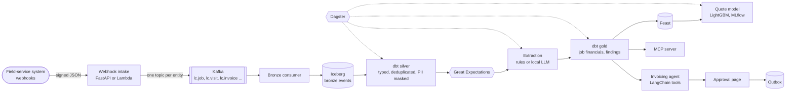

# Architecture

## Layers

| Layer | What it holds | Where it runs locally | Where it runs in the cloud stacks |
|---|---|---|---|
| Intake | Signed webhook events, rejected unless the HMAC matches | FastAPI (`leakcheck serve`) | API Gateway HTTP API and Lambda |
| Event bus | One Kafka topic per entity, keyed by entity id | Kafka in KRaft mode (Homebrew, or a container in CI) | Confluent Cloud |
| Bronze | Every event as received, partitioned by entity | Iceberg with a SQL catalog | Iceberg on S3, Glue catalog, Athena |
| Silver | Typed, deduplicated latest versions; customer identifiers masked | dbt on DuckDB | dbt on Snowflake, masking policy |
| Quality | Expectations a contractor's records must meet | Great Expectations | same |
| Signals | Labels on messages and crew notes | rules or qwen2.5:7b through Ollama | Snowflake Cortex or Azure OpenAI |
| Gold | Job financials, extra-work signals, findings, quote features | dbt on DuckDB | dbt on Snowflake |
| Features and model | Quote-time features; hours model and registry | Feast (SQLite online store), MLflow (SQLite) | Feast on Snowflake and Redis |
| Agent | Tools, drafts, approvals, audit | LangChain with Ollama; FastAPI page | Azure Functions with Azure OpenAI |
| Orchestration | Assets and a daily schedule | Dagster | Dagster |

Everything in the local column has run and is measured in the README. The cloud column is
written (Terraform in `infra/terraform`, an Azure DevOps pipeline, Lambda and Function
handlers that are unit tested) and validated in CI, but has not been deployed.

## Four rules the design keeps

1. **The model never writes an amount.** The drafting tool takes finding ids; amounts come
   from gold. The agent evaluation checks every drafted amount against the warehouse.
2. **Bronze is never edited.** Kafka delivery is at least once and webhooks can repeat; silver
   drops duplicates by event id and keeps the latest version of each entity.
3. **Nothing reaches the customer without the owner.** Drafts wait on the approval page;
   approving moves them to an outbox, and every tool call and decision is in the audit table.
4. **A step that must always happen is not a tool call.** Creating a draft notifies the
   owner in the same transaction. The agent used to be asked to call `notify_owner`
   afterwards and, on 35 of 100 held-out jobs, passed a draft id it had invented; the tool
   rejected it and the owner heard nothing. The README has the measurement on both designs.

## Leak detectors

| Detector | Pricing | Fires when | Reads text? |
|---|---|---|---|
| Uninvoiced job | any | completed more than 14 days before the as-of date, no final invoice | no |
| Unbilled hours | time and materials | billable hours logged exceed hours invoiced (no-charge callbacks excluded) | crew notes |
| Unbilled materials | time and materials | job materials plus markup exceed materials invoiced (shop stock excluded) | expense descriptions |
| Unbilled extra work | fixed price | customer asked for extra work, contractor agreed or crew notes say it was done, no change order | messages and notes |
| Unapproved discount | fixed price | invoiced below the approved quote, beyond any discount line or promised credit | contractor messages |
